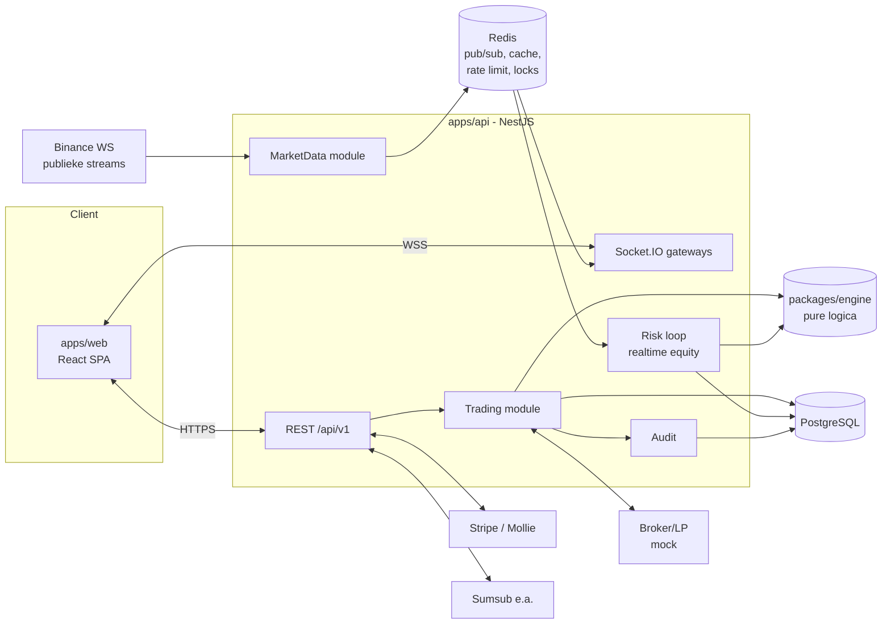

# Architectuur — Fase 0

## 1. Repo-structuur

```
/
├─ CLAUDE.md
├─ package.json                 # root scripts (dev, build, test, lint, typecheck)
├─ pnpm-workspace.yaml
├─ tsconfig.base.json
├─ docker-compose.yml           # postgres, redis, mailpit, api, web
├─ .env.example
├─ .github/workflows/ci.yml     # install → lint → typecheck → unit → build → e2e
├─ docs/
│  ├─ architecture.md  datamodel.md  api.md  roadmap.md  decisions.md
├─ apps/
│  ├─ web/
│  │  ├─ src/
│  │  │  ├─ app/               # router, providers (Query, i18n, theme), layouts
│  │  │  ├─ config/brand.ts    # BRAND-naam, logo, links — enige plek voor merk
│  │  │  ├─ styles/tokens.css  # ALLE kleuren/radii/schaduwen als CSS-variabelen
│  │  │  ├─ styles/globals.css # Tailwind v4 @theme mapt op tokens
│  │  │  ├─ components/ui/     # design system (shadcn-basis): Button, Card, Accordion,
│  │  │  │                     # Slider, Stepper, Badge, Meter, Tabs, Modal, Toast …
│  │  │  ├─ components/motion/ # Reveal, CountUp, DrawLine, FloatCard (reduced-motion aware)
│  │  │  ├─ features/
│  │  │  │  ├─ landing/ auth/ dashboard/ terminal/ challenge/ accounts/
│  │  │  │  ├─ billing/ payouts/ profile/ security/ admin/
│  │  │  ├─ lib/               # api (gegenereerde client), ws (socket + reconnect), format, money
│  │  │  ├─ stores/            # zustand: theme, activeAccount, connection, terminal-layout
│  │  │  ├─ locales/nl/*.json  locales/en/*.json
│  │  │  └─ mocks/             # MSW — alleen dev/test
│  │  └─ e2e/                  # Playwright
│  └─ api/
│     ├─ prisma/ schema.prisma  migrations/  seed.ts
│     └─ src/
│        ├─ main.ts  app.module.ts  config/ (env-validatie)
│        ├─ common/            # guards (auth, roles, step-up 2FA), idempotency-interceptor,
│        │                     # problem-details filter, throttling, crypto (veldversleuteling)
│        ├─ modules/
│        │  ├─ auth/ users/ kyc/ catalog/ checkout/ invoices/
│        │  ├─ accounts/ trading/ market-data/ risk/ payouts/ broker/
│        │  ├─ admin/ audit/ notifications/ public/ health/
│        └─ gateways/          # Socket.IO: /market, /account
└─ packages/
   ├─ shared/                  # enums, foutcodes, WS-eventtypes, generated/openapi.d.ts, client.ts
   ├─ engine/                  # pure domeinlogica (zie §3) — voorstel, zie vraag Q1
   (eslint/prettier/tsconfig-config staat in de root; docker/dev.Dockerfile voor compose)
```

## 2. Systeemoverzicht



### Datastroom prijzen
1. `BinanceMarketDataAdapter` (implementeert `MarketDataAdapter`) verbindt met publieke **USDⓈ-M futures**-streams (`bookTicker` voor bid/ask, `markPrice@1s` voor mark price + funding rate, `kline_*` voor candles). Auto-reconnect + heartbeat; bij 24u-disconnect van Binance proactief herverbinden.
2. Genormaliseerde `Quote { instrumentId, bid, ask, ts, source }` → Redis pub/sub `quotes:{symbol}` + laatste quote in Redis-hash.
3. Afnemers: **Risk loop** (elke tick), **pending-order matcher** (limit/stop), **WS-gateway** (gethrottled naar clients, max ~4 updates/s per symbool).
4. Historische candles: REST-proxy naar Binance klines met Redis-cache.

Interface (indicatief):
```ts
interface MarketDataAdapter {
  readonly source: string;
  connect(): Promise<void>;
  subscribe(symbols: string[]): void;
  onQuote(cb: (q: Quote) => void): Unsubscribe;
  onCandle(cb: (c: Candle) => void): Unsubscribe;
  getCandles(symbol: string, tf: Timeframe, from: Date, to: Date): Promise<Candle[]>;
  status(): AdapterStatus; // connected | reconnecting | down
}
```
Later: `PolygonAdapter`, `DatabentoAdapter`, forex-adapter — zelfde interface.

**Stale-data-bescherming**: als een feed > N seconden geen quote levert, worden nieuwe orders op dat instrument geweigerd (`MARKET_DATA_STALE`) en wordt de risk loop voor dat instrument niet op oude prijzen gebaseerd.

## 3. Simulatie-engine (`packages/engine`)

Pure functies/klassen, geen IO, `bigint` overal.

- **money/fixed-point**: conversies prijs × qty → notional in cents, half-even afronding, bps-berekeningen.
- **Ordertypes**: market, limit, stop (stop-market). SL/TP als gekoppelde (OCO-achtige) close-orders op de positie. Time-in-force: GTC (voorlopig).
- **Fill-model**:
  - Execution prijs = Binance bid/ask + **spread-markup** (bps per instrument, configureerbaar).
  - **Slippage** voor market/stop: `vaste bps + f(orderNotional / referentieliquiditeit)`, begrensd door max-slippage.
  - Limit vult wanneer de ask (buy) ≤ limit of bid (sell) ≥ limit; vult op limietprijs (geen positieve slippage).
  - Stop triggert op bid/ask-cross en wordt een market-fill met slippage.
- **Posities**: modus **netting** (één positie per instrument per account) — zie vraag Q4. Gemiddelde instapprijs, partial close, gerealiseerde/ongerealiseerde PnL.
- **Margin**: `initialMargin = notional / leverage`; `marginLevel = equity / usedMargin`; margin call- en stop-out-niveau per rule set (bv. stop-out bij 50%).
- **Funding/financing**: per instrument `fundingIntervalHours` + `fundingRateLongBps/ShortBps` (fallback). Standaard: echte funding rate uit Binance `markPrice`-stream, elke 8 uur afgerekend.
- **Fees**: commissie per instrument (bps van notional) → ledger.
- **Equity** = balance + Σ unrealized PnL − openstaande fundingkosten.

### Concurrency
- Orderplaatsing: transactie met `SELECT … FOR UPDATE` op `TradingAccount` → validatie → fill → ledger → audit → commit → event naar Redis → WS.
- Risk loop: in-memory index `instrumentId → accounts met open posities`. Bij elke quote: equity herberekenen voor getroffen accounts; bij overschrijding → liquidatie/fail via dezelfde gelockte transactie-flow (geen dubbele close door idempotente "breach"-actie per account).
- Fase 3–8: één API-proces draait de risk loop (leader via Redis-lock). Horizontaal schalen later door accounts te sharden.

## 4. Challenge-regelengine

Configuratie per **RuleSet** (onveranderlijk, geversioneerd) per fase van een product:

| Regel | Velden |
|---|---|
| Profit target | `profitTargetBps` (null bij funded/instant) |
| Max daily loss | `maxDailyLossBps`, `dailyLossBasis` (INITIAL_BALANCE \| DAY_START), `dailyLossReference` (DAY_START_BALANCE \| DAY_START_EQUITY \| MAX_OF_BOTH), `dailyResetTz` + `dailyResetTime` |
| Max drawdown | `maxDrawdownBps`, `drawdownType` (STATIC \| TRAILING), `trailingBasis` (EQUITY \| BALANCE), `trailingLocksAtInitial` (bool) |
| Handelsdagen | `minTradingDays`, optioneel `maxDurationDays` |
| Overig | `maxLeverage`, toegestane instrumenten, `stopOutLevelBps`, `profitSplitBps` (funded), optioneel consistentieregel (later) |

- **Realtime** (elke tick): daily loss en max drawdown op equity → bij overschrijding direct alle posities sluiten, account `FAILED`, `RuleViolation` + audit.
- **Bij elke gesloten trade/dagwissel**: profit target + min. handelsdagen → bij behalen: `PASSED` → volgende fase aanmaken, of (laatste fase) **promotie naar funded** (status `PENDING_FUNDED` tot KYC/contract is afgerond — zie Q9).
- Meters in de UI: blauw = veilig (< 70% van limiet), geel = bijna (70–<100%), rood = overschreden. Drempels instelbaar.
- Engine-tests (fase 4): property-based + scenariotests (gap-moves, trailing-lock, dagwissel rond middernacht/DST, gelijktijdige breach + target).

## 5. Adapters (allemaal interface + mock)

| Interface | Eerste implementatie | Opmerking |
|---|---|---|
| `MarketDataAdapter` | Binance (publieke streams) | Polygon/Databento/forex later |
| `PaymentProvider` | Mock; Stripe/Mollie later (D11) | webhooks idempotent via `WebhookEvent` |
| `KycProvider` | Mock; Sumsub-adapter in fase 9 | status via webhook |
| `BrokerAdapter` | Mock | `openAccount`, `getBalance`, `placeOrder`, `syncPositions`, `onExecution`. Geen klantgeld bij ons. |
| `PayoutProvider` | Placeholder (handmatig "markeer betaald") | |
| `Mailer` | Mailpit lokaal, SMTP/provider in prod | |

## 6. Security

- Wachtwoorden: argon2id. E-mailverificatie verplicht.
- Tokens: access-JWT (15 min, in geheugen), refresh-token (roterend, httpOnly + Secure + SameSite=Strict cookie, opgeslagen als hash, reuse-detectie revoked de hele familie).
- 2FA: TOTP (RFC 6238) + 10 eenmalige recovery-codes (gehasht). **Verplicht voor ADMIN en SUPPORT**; step-up (opnieuw TOTP) voor admin-overrides, uitbetalingsverzoeken en 2FA-wijzigingen.
- Rollen: `TRADER`, `SUPPORT` (lezen + notities, geen financiële overrides), `ADMIN`.
- Rate limiting (Redis): login/2FA 5/min per IP+e-mail, registratie 3/uur per IP, orders 20/s per account, overig 120/min per gebruiker.
- Helmet/CSP, CORS whitelist, Zod/class-validator op alle input, Prisma (geen raw SQL zonder parameters).
- Veldversleuteling PII (AES-256-GCM, sleutelversie in ciphertext voor rotatie).
- Audit log hash-keten + periodieke verificatie-endpoint.

## 7. Frontend-architectuur

- **Server state**: TanStack Query (gegenereerde client). **Realtime**: Socket.IO-client; events patchen de Query-cache. **Client state**: Zustand (thema, actief account, verbindingsstatus, terminal-layout).
- **Optimistische orders**: order verschijnt direct als `PENDING` met `clientOrderId`; server-bevestiging via REST-response en `order.update` op WS; rollback + toast bij weigering.
- **Reconnect**: exponential backoff (1s → 30s, jitter), banner "Verbinding verbroken — opnieuw verbinden…", na reconnect `resync` met laatst bekende `seq` → server stuurt snapshot.
- Routes: `/` (landing), `/login`, `/register`, `/2fa`, `/app/dashboard`, `/app/terminal`, `/app/challenge`, `/app/accounts`, `/app/payouts`, `/app/billing`, `/app/profile`, `/app/security`, `/admin/*`. Code-splitting per route.
- i18n: `nl` standaard, `en` beschikbaar, taal in URL-prefix (`/en` standaard, `/nl`, `/es`), `hreflang`-tags, lazy-geladen vertalingen.

## 8. Lokaal draaien & CI

- `docker compose up` → postgres:16, redis:7, mailpit, api (watch), web (vite).
- CI (GitHub Actions): pnpm-cache → lint → typecheck → vitest (engine + api met Postgres/Redis services) → build → Playwright (fase 9 volledig; smoke vanaf fase 2) → OpenAPI-drift-check (gegenereerde client moet up-to-date zijn).
