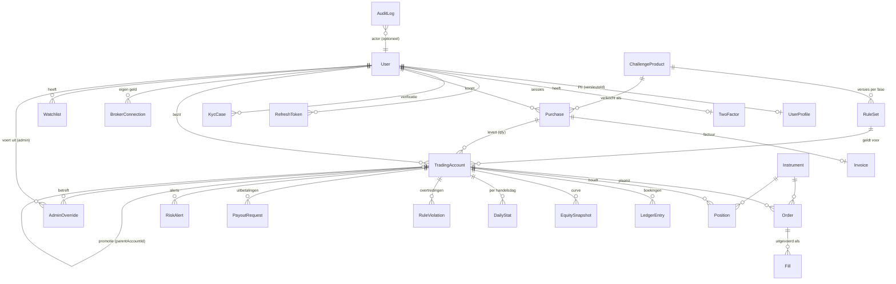

# Datamodel (ERD) — Fase 0

Conventies: `id` = UUIDv7 (tijd-sorteerbaar) tenzij anders vermeld; `*Minor` = `BigInt` in cents van `currency`; prijzen/qty = `BigInt` fixed-point met de decimalen van het instrument; `*Bps` = `Int` basispunten; alle tijden `timestamptz` (UTC).

## ERD

## Tabellen

### Identiteit & toegang
**User** — `id`, `email` (uniek, lowercase), `emailVerifiedAt`, `passwordHash` (argon2id), `roles` (enum[] TRADER/SUPPORT/ADMIN), `status` (ACTIVE/SUSPENDED/PENDING_DELETION/DELETED), `locale` (nl/en), `country` (ISO-2, nodig voor restricties/BTW), `createdAt`, `lastLoginAt`.

**UserProfile** (PII, versleuteld) — `userId` (PK/FK), `firstNameEnc`, `lastNameEnc`, `dateOfBirthEnc`, `addressEnc`, `phoneEnc`, `marketingConsentAt`, `termsAcceptedAt`, `termsVersion`.

**TwoFactor** — `userId`, `totpSecretEnc`, `enabledAt`, `recoveryCodeHashes` (text[]), `lastUsedStep` (replay-bescherming).

**RefreshToken** — `id`, `userId`, `familyId`, `tokenHash`, `userAgent`, `ipHash`, `expiresAt`, `revokedAt`, `replacedById`.

**KycCase** — `id`, `userId`, `provider`, `externalId`, `level`, `status` (NOT_STARTED/PENDING/APPROVED/REJECTED/RESUBMIT), `reviewedAt`, `rejectReasonCode`.

### Catalogus & betalingen
**ChallengeProduct** — `id`, `slug`, `type` (INSTANT/ONE_STEP/TWO_STEP), `accountSizeMinor`, `priceMinor`, `currency`, `phases` (int), `isRecommended`, `isActive`, `sortOrder`.

**RuleSet** (onveranderlijk) — `id`, `productId`, `version`, `phaseIndex` (0..n, funded = laatste), `isFunded`, `profitTargetBps?`, `maxDailyLossBps`, `dailyLossBasis`, `dailyLossReference`, `dailyResetTz`, `dailyResetTime`, `maxDrawdownBps`, `drawdownType`, `trailingBasis`, `trailingLocksAtInitial`, `minTradingDays`, `maxDurationDays?`, `maxLeverage`, `stopOutLevelBps`, `allowedInstrumentIds` (uuid[]), `profitSplitBps?`, `payoutIntervalDays?`, `createdAt`, `createdById`. Uniek: (`productId`, `phaseIndex`, `version`).

**Purchase** — `id`, `userId`, `productId`, `quantity`, `unitPriceMinor`, `vatMinor`, `totalMinor`, `currency`, `provider` (STRIPE/MOLLIE), `providerPaymentId` (uniek), `status` (PENDING/PAID/FAILED/REFUNDED/EXPIRED), `idempotencyKey`, `paidAt`.

**Invoice** — `id`, `purchaseId`, `number` (doorlopend per jaar, bv. `2026-000123`, uniek), `issuedAt`, `billingSnapshot` (jsonb, NAW op moment van factuur), `pdfStorageKey`.

**WebhookEvent** — `id`, `provider`, `externalEventId` (uniek per provider), `type`, `payload` jsonb, `receivedAt`, `processedAt`, `error`.

**PriceQuote** (custom configurator) — `id`, `userId?`, `type`, `accountSizeMinor`, `options` jsonb, `priceMinor`, `currency`, `ruleSetDraft` jsonb, `expiresAt`.

**CountryRestriction** — `countryCode` (PK), `level` (BLOCKED/NO_PAYOUT/REVIEW), `source` (EU_SANCTIONS/FATF_BLACK/FATF_GREY/MANUAL), `updatedAt`, `updatedById`.

**IdempotencyKey** — `key` + `userId` (PK), `route`, `requestHash`, `responseStatus`, `responseBody` jsonb, `createdAt`, `expiresAt` (24u).

### Trading
**Instrument** — `id`, `symbol` (bv. BTCUSDT), `displayName`, `assetClass` (CRYPTO/FX/INDEX/…), `baseAsset`, `quoteAsset`, `priceDecimals`, `qtyDecimals`, `tickSize`, `minQty`, `qtyStep`, `contractSize`, `maxLeverage`, `spreadMarkupBps`, `commissionBps`, `slippageBaseBps`, `slippageMaxBps`, `fundingIntervalHours`, `fundingRateLongBps`, `fundingRateShortBps`, `marketDataSource`, `externalSymbol`, `isActive`, `tradingHours` jsonb (24/7 voor crypto).

**TradingAccount** — `id`, `userId`, `kind` (CHALLENGE/FUNDED/LIVE_BROKER), `isSimulated` (bool, altijd true voor CHALLENGE/FUNDED), `purchaseId?`, `ruleSetId?`, `parentAccountId?`, `phaseIndex`, `status` (ACTIVE/PASSED/FAILED/PENDING_FUNDED/FUNDED_ACTIVE/SUSPENDED/CLOSED), `currency`, `initialBalanceMinor`, `balanceMinor`, `highWaterMarkMinor`, `dayStartBalanceMinor`, `dayStartEquityMinor`, `currentTradingDate`, `tradingDaysCount`, `version` (optimistic lock), `startedAt`, `endedAt`, `failReason?`, `brokerConnectionId?`, `seq` (eventvolgnummer voor WS-resync).

**Order** — `id`, `accountId`, `clientOrderId` (uniek per account), `instrumentId`, `side` (BUY/SELL), `type` (MARKET/LIMIT/STOP), `qty`, `limitPrice?`, `stopPrice?`, `slPrice?`, `tpPrice?`, `leverage`, `reduceOnly`, `parentPositionId?` (SL/TP-orders), `timeInForce` (GTC), `status` (PENDING/OPEN/PARTIALLY_FILLED/FILLED/CANCELLED/REJECTED/TRIGGERED), `filledQty`, `avgFillPrice?`, `rejectCode?`, `source` (USER/SYSTEM_SL/SYSTEM_TP/SYSTEM_STOPOUT/SYSTEM_BREACH/ADMIN), `createdAt`, `updatedAt`.

**Fill** — `id`, `orderId`, `accountId`, `instrumentId`, `side`, `qty`, `price`, `referencePrice` (bid/ask vóór markup), `spreadCostMinor`, `slippageCostMinor`, `commissionMinor`, `realizedPnlMinor`, `executedAt`.

**Position** — `id`, `accountId`, `instrumentId`, `side`, `qty`, `avgEntryPrice`, `leverage`, `usedMarginMinor`, `realizedPnlMinor`, `fundingAccruedMinor`, `slPrice?`, `tpPrice?`, `status` (OPEN/CLOSED), `openedAt`, `closedAt`, `lastFundingAt`. Uniek (netting): (`accountId`, `instrumentId`) waar `status = OPEN`.

**LedgerEntry** (append-only; balans = som) — `id` (bigserial), `accountId`, `type` (INITIAL_CAPITAL/REALIZED_PNL/COMMISSION/FUNDING/PAYOUT/ADJUSTMENT/RESET), `amountMinor` (±), `balanceAfterMinor`, `refType`, `refId`, `createdAt`.

**EquitySnapshot** — `accountId`, `ts`, `balanceMinor`, `equityMinor`, `usedMarginMinor`. Elke minuut bij open posities + bij elk event; later gedownsampled (1m → 1h na 30 dagen). Index (`accountId`, `ts`). Kandidaat voor partitionering per maand.

**DailyStat** — `accountId`, `tradingDate` (PK samen), `startBalanceMinor`, `startEquityMinor`, `minEquityMinor`, `maxEquityMinor`, `closedPnlMinor`, `tradesCount`, `isTradingDay`.

**RuleViolation** — `id`, `accountId`, `ruleSetId`, `rule` (DAILY_LOSS/MAX_DRAWDOWN/MAX_DURATION/STOP_OUT/…), `thresholdMinor`, `observedMinor`, `quoteSnapshot` jsonb, `action` (FAIL/WARN), `createdAt`.

**Watchlist** — `userId`, `instrumentIds` (uuid[], geordend), `updatedAt`.

### Uitbetalingen & broker
**PayoutRequest** — `id`, `accountId`, `userId`, `grossProfitMinor`, `traderShareMinor`, `currency`, `status` (REQUESTED/APPROVED/REJECTED/PAID/CANCELLED), `method` (placeholder), `reviewedById?`, `reviewedAt?`, `paidAt?`, `externalRef?`.

**BrokerConnection** — `id`, `userId`, `provider`, `externalAccountId`, `status` (PENDING/ACTIVE/ERROR/DISCONNECTED), `lastSyncAt`, `lastBalanceMinor`, `currency`. Credentials/tokens van de broker versleuteld of bij voorkeur alleen bij de broker.

### Beheer & compliance
**AdminOverride** — `id`, `adminId`, `accountId?`, `userId?`, `action` (ADJUST_BALANCE/SET_STATUS/EXTEND_DURATION/RESET_DAILY/FORCE_PASS/FORCE_FAIL/…), `before` jsonb, `after` jsonb, `reason` (verplicht), `createdAt`.

**RiskAlert** — `id`, `type` (NEAR_DAILY_LOSS/NEAR_DRAWDOWN/BREACH/HIGH_LEVERAGE/ABNORMAL_PNL/MULTI_ACCOUNT_SUSPECT/STALE_FEED/…), `severity` (INFO/WARN/CRITICAL), `accountId?`, `userId?`, `details` jsonb, `status` (OPEN/ACKNOWLEDGED/RESOLVED), `assignedToId?`, `createdAt`, `resolvedAt`.

**AuditLog** (onveranderlijk) — `id` (bigserial), `ts`, `actorType` (USER/ADMIN/SUPPORT/SYSTEM), `actorId?`, `action` (bv. `order.placed`, `rule.breached`, `admin.override`), `entityType`, `entityId`, `data` jsonb (geen PII), `requestId`, `ipHash?`, `prevHash`, `hash` (SHA-256 over prevHash + inhoud). DB: trigger die UPDATE/DELETE weigert; app-rol heeft alleen INSERT/SELECT.

## GDPR-notities
- PII alleen in `UserProfile` + `Invoice.billingSnapshot` (wettelijke bewaarplicht facturen 7 jaar NL).
- IP-adressen alleen gehasht (met pepper) in logs.
- Verwijderverzoek: profiel wissen, e-mail vervangen door pseudoniem, financiële records/audit behouden (pseudoniem gekoppeld).
- Data-export endpoint (JSON) voor inzagerecht.

## Status fase 6 (geïmplementeerd)

- `Product` (catalogus, verwijst naar een vaste `RuleSet`-versie), `PriceQuote` (configurator, 30 min), `Purchase` (snapshot van grootte, stukprijs, totaal, regelversie; status `PENDING → PAID → FULFILLED` of `FAILED`/`CANCELLED`; DB-checks: aantal 1–5, totaal = stukprijs × aantal, precies één van product/offerte), `PaymentEvent` (uniek per provider + eventId).
- `RuleSet` kreeg nullable uitbetalings-/scalingvelden (`payoutIntervalDays`, `minTradingDaysPerPayout`, `minPayoutMinor`, `scalingProfitTargetBps`, `scalingMinPayouts`, `scalingStepBps`, `scalingMaxBalanceMinor`); bestaande versies blijven ongewijzigd (v1 = null).
- `TradingAccount` kreeg `purchaseId`, `payoutCycleStartedAt`, `cycleTradingDays`, `payoutsCount`, `payoutBaselineMinor`, `paidOutSinceScaleMinor`.
- Het ERD hierboven gebruikt nog `ChallengeProduct`; in de code heet dit `Product`.

## Multi-tenant & admin (fase 8, geïmplementeerd)

- **Firm** — `id`, `slug` (uniek, `[a-z0-9-]`), `name`, `status` (ACTIVE/SUSPENDED), `domain?` (uniek), `primaryColor?` (`#RRGGBB`), `logoDataUrl?`, `supportEmail?`. Standaardfirma `daily-funded` (migratie) bevat alle bestaande data.
- `User.firmId` (verplicht) + `User.firmRole?` (OWNER/ADMIN/SUPPORT); uniek `(firmId, email)` i.p.v. globaal uniek e-mailadres.
- `RuleSet.firmId?`: null = Daily Funded-sjabloon (uniek `(code, version)` via partiële index), anders eigen versie van een firma (uniek `(firmId, code, version)`). Rijen blijven onveranderlijk.
- `Product.firmId`, `Competition.firmId` (slug uniek per firma).
- `AuditLog.firmId?`: door de audit-service afgeleid uit actor of entiteit; telt alleen mee in de hash als het gevuld is, zodat oudere rijen blijven verifiëren.
- **RiskAlert** (vervangt het eerdere ontwerp hierboven) — `firmId`, `accountId`, `userId`, `type` (BREACH/NEAR_BREACH/LARGE_LOSS), `severity` (INFO/WARNING/CRITICAL), `dedupKey` (uniek), `details` jsonb (geen PII), `ackAt?`, `ackById?`.
- `AdminOverride` (ontwerp) is niet gebouwd: admins passen geen saldi aan (D86).
